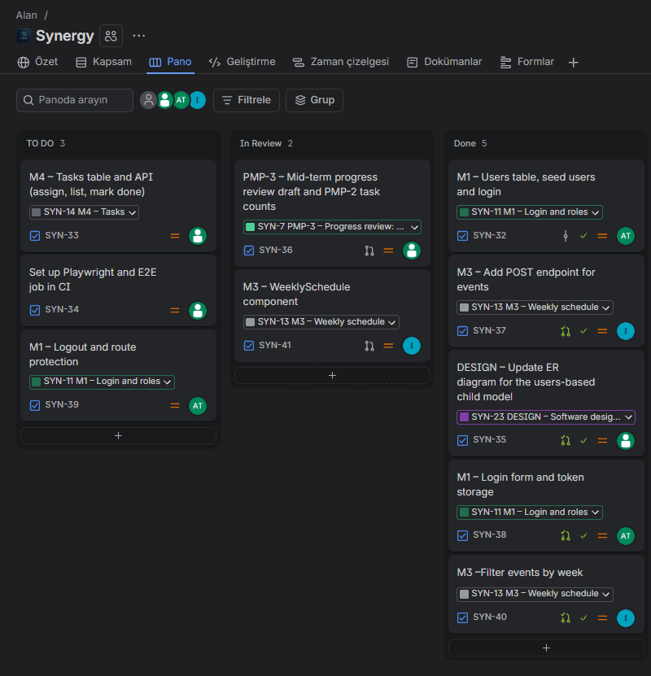

# Project Management Plan (PMP)

> The purpose of this PMP is to practice planning and tracking work in Jira. Keep it short: most of the content is a summary of what you set up in Jira.
> Keep this file at `docs/PMP.md`. Each section is one Jira epic (PMP-1 … PMP-6); mark the epic Done when the section is complete.
> Save screenshots in `docs/img/`.

| Section | Content | Required by |
|---|---|---|
| PMP-1 | Project, Jira setup, team and roles | Week 6 |
| PMP-2 | Work packages (epics) and sprint plan | Week 6 |
| PMP-3 | Progress review: mid-term (v0.1) | Mid-term evaluation (Week 8 / 9) |
| PMP-4 | Progress review: v0.2 | Week 10 |
| PMP-5 | Progress review: final (v1.0) | Final evaluation |
| PMP-6 | Retrospective | Final evaluation |

---

## PMP-1. Project and Team

### Project and Jira Setup

**Project in one sentence:** A web-based decision support platform that brings a child's parent and specialists (teachers, psychologists, doctors, coaches) together around one shared weekly schedule, task list and record of observations, with an AI-generated, role-based weekly summary that supports but never makes decisions.  
**Jira project key:** SYN  
**Jira board link:** https://team-synergy.atlassian.net/jira/software/projects/SYN/boards/1  
**GitHub repository:** https://github.com/BKaanC/Seng_383_Project (connected to Jira with the GitHub for Jira app)  
**Team:** Synergy · Group G-4 · Section 2

### Team and Roles

| Name | Jira / GitHub username | Role |
|---|---|---|
| Bekir Kaan Çalışkan | Bekir Kaan Çalışkan / BKaanC | Project Manager (team contact person), Tester, Developer |
| Aleyna Tanrıverdi | Aleyna Tanrıverdi / alynatanrvrdi66 | Project Manager, Tester, Developer |
| Irmak Konak | Irmak Konak / irrmak | Project Manager, Tester, Developer |

**Working agreement:**

- Every task in Jira belongs to an epic and has exactly one assignee.
- Every branch and commit message starts with the Jira issue key (e.g., branch `SYN-12-login-validation`, commit `SYN-12 Add login form validation`).
- The `main` branch is protected: changes are merged only through pull requests reviewed and approved by another team member, after CI passes.
- A task is moved to Done only after its work is merged into `main`.

---

## PMP-2. Plan

### Work Packages (Epics)

Development is split by module, so every member works on both frontend and backend. The team uses one-week sprints (Monday–Sunday). Section 2 has class on Mondays, so each in-class milestone is reached by the end of the sprint before it. Task counts are taken from Jira on 15 November 2026 and are updated at the end of each sprint.

| Epic | Owner | Number of tasks | Planned sprint(s) |
|---|---|---|---|
| PMP-1 – Project, Jira setup, team and roles | Bekir Kaan Çalışkan | 1 | Sprint 1 |
| PMP-2 – Work packages and sprint plan | Bekir Kaan Çalışkan | 1 | Sprint 2 |
| PMP-3 – Progress review: mid-term (v0.1) | Bekir Kaan Çalışkan | 1 | Sprint 4 |
| PMP-4 – Progress review: v0.2 | Bekir Kaan Çalışkan | 0 | Sprint 5 |
| PMP-5 – Progress review: final (v1.0) | Bekir Kaan Çalışkan | 0 | Sprint 7 |
| PMP-6 – Retrospective | Bekir Kaan Çalışkan | 0 | Sprint 8 |
| SRS – Software requirements specification | Bekir Kaan Çalışkan (each member writes own modules) | 4 | Sprint 2 (first), Sprint 7 (final) |
| DESIGN – Software design document | Bekir Kaan Çalışkan (each member writes own modules) | 1 | Sprint 2 (first), Sprint 7 (final) |
| M1 – Login and roles | Aleyna Tanrıverdi | 4 | Sprint 2–5 |
| M2 – Linking specialists | Aleyna Tanrıverdi | 0 | Sprint 3–5 |
| M3 – Weekly schedule | Irmak Konak | 7 | Sprint 1–2, Sprint 3–5 |
| M4 – Tasks | Bekir Kaan Çalışkan | 1 | Sprint 4–5 |
| M5 – Specialist entries | Irmak Konak | 0 | Sprint 5–7 |
| M6 – Documents | Aleyna Tanrıverdi | 0 | Sprint 5–7 |
| M7 – Weekly statistics | Bekir Kaan Çalışkan | 0 | Sprint 5–7 |
| M8 – Role-based AI summary | Irmak Konak | 0 | Sprint 5–7 |

**Cross-module responsibilities:**

- Aleyna Tanrıverdi: backend foundation, authentication (JWT) and access-control middleware used by all modules.
- Irmak Konak: frontend foundation (React client); AI integration with the Gemini API, including the mandatory mock mode.
- Bekir Kaan Çalışkan: CI pipeline and end-to-end test setup (Playwright); team contact and PMP.

**AI provider:** Gemini API (free tier, Flash models). GitHub Models, the other option in the assignment, was retired by GitHub on 30 July 2026.

### Sprint Plan

| Sprint | Weeks | Sprint goal | Ends with |
|---|---|---|---|
| Sprint 1 | Week 4 (19–25 Oct) | Jira and repository setup, PMP-1, React client skeleton | Jira connected to GitHub, PMP-1 done |
| Sprint 2 | Week 5 (26 Oct–1 Nov) | Express server and SQLite skeleton, SRS and SDD templates, module split; walking skeleton, SRS and SDD first version, PMP-2 | Walking skeleton (v0.0), shown in class on 2 Nov (Week 6) |
| Sprint 3 | Week 6 (2–8 Nov) | M1 login and roles (JWT); start of M2, M3 and M4 | M1 working end to end |
| Sprint 4 | Week 7 (9–15 Nov) | M1 login and roles; M3 weekly schedule and M4 tasks in progress; PMP-3 | M1 login in `main`, PMP-3 done |
| Sprint 5 | Week 8 (16–22 Nov) | Finish M1–M4 (including M2); first end-to-end test running in CI; PMP-4 | Release v0.1 (M1–M4), mid-term demo in class on 23 Nov (Week 9) |
| Sprint 6 | Week 9 (23–29 Nov) | M5–M8 development; end-to-end tests for 3 critical flows | M5–M8 feature complete |
| Sprint 7 | Week 10 (30 Nov–6 Dec) | Branch coverage ≥ 40%; SRS and SDD final; PMP-5 | Release v0.2 (M1–M8), Week 10 |
| Sprint 8 | Week 11 (7–13 Dec) | An end-to-end test for each of M1–M8, branch coverage ≥ 60%, final report, PMP-6, presentation | Release v1.0, final demo in class on 14 Dec (Week 12) |

---

## PMP-3. Progress Review: Mid-term (v0.1)

Review at the end of Sprint 4 (15 November 2026, Week 7). Statuses are taken from Jira; an item is Done when its pull request is merged into `main`.

**Jira board screenshot:** 

| Epic | Planned for this point | Status (Done / In progress / Not started) |
|---|---|---|
| PMP-1 – Project, Jira setup, team and roles | Complete (Sprint 1) | Done |
| PMP-2 – Work packages and sprint plan | Complete (Sprint 2) | Done |
| PMP-3 – Progress review: mid-term (v0.1) | Complete (Sprint 4) | Done |
| SRS – Software requirements specification | First version and module reviews (Sprints 2–3) | Done (final version in Sprint 7) |
| DESIGN – Software design document | First version (Sprint 2) | Done for the first version; updated for the new data model in Sprint 4 |
| M1 – Login and roles | Working end to end (Sprint 3) | In progress: login API, JWT and login screen are in `main`; logout and route protection remain |
| M2 – Linking specialists | Working (Sprint 4) | Not started |
| M3 – Weekly schedule | Working (Sprint 4) | In progress: list, add and weekly filter of events are in `main`; weekly schedule screen in review |
| M4 – Tasks | Working (Sprint 4) | Not started |
| Test infrastructure (Playwright) | First end-to-end test in CI (Sprint 5) | Not started |

**Changes to the plan:**

- **M1 moved one sprint later.** Sprint 3 delivered the SRS module reviews (SYN-27, SYN-30) and a fix for the development proxy on Windows (SYN-31), but M1 development started only at the end of the sprint. M1's backend and login screen were merged in Sprint 4. M2 and M4 depend on M1 for login and access checks, so they move to Sprint 5, which is now used to finish M1–M4 for the v0.1 demo on 23 November.
- **Data model.** Children are stored in the `users` table (role `child`, `parent_id`) instead of a separate CHILD table, because every child also logs in. Every `child_id` is the child's `users.id`. The SDD was updated (SYN-35).
- **API paths.** Login uses `POST /api/login` and `GET /api/me`; the SDD API table was updated to match.
- **Smaller tasks.** From Sprint 4, each member creates their own Jira tasks and splits module work into tasks of half a day to one day.
- **Merge method.** From Sprint 4, pull requests are merged with "Rebase and merge" or "Create a merge commit" instead of "Squash and merge", so each commit appears in `main` under its author.
- **PMP schedule.** Aligned with the course plan: PMP-3 in Week 7, PMP-4 in Week 8, PMP-5 in Week 10 and PMP-6 in Week 11 (see the sprint plan above).

---

## PMP-4. Progress Review: v0.2

**Jira board screenshot:**  

| Epic | Planned for this point | Status (Done / In progress / Not started) |
|---|---|---|
| | | |
| | | |

**Changes to the plan (if any):**

---

## PMP-5. Progress Review: Final (v1.0)

**Jira board screenshot:**  

| Epic | Planned for this point | Status (Done / In progress / Not started) |
|---|---|---|
| | | |
| | | |

**Changes to the plan (if any):**

---

## PMP-6. Retrospective

- What worked well in using Jira:
- What we would do differently:
