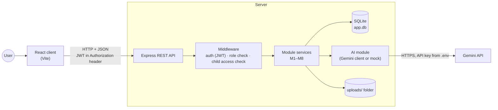
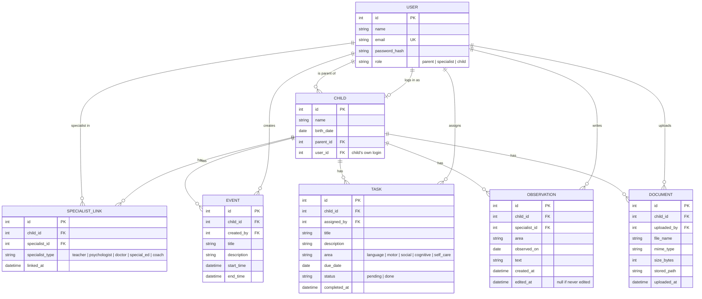
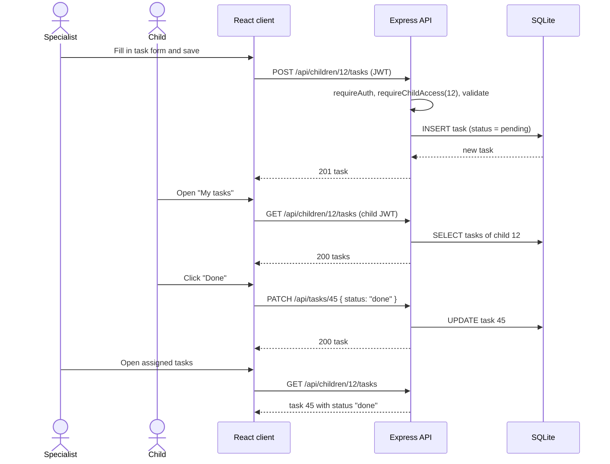
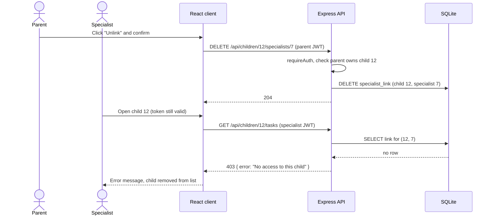
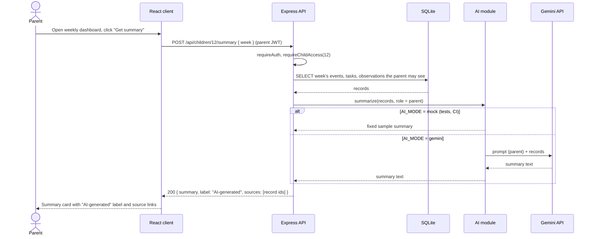

# Software Design Document (SDD)

**Team name:** Synergy  
**Version:** ☑ First version (Week 6) ☐ Final (Week 10)  
**Last updated:** 2026-11-02

---

## 1. Architecture Overview

Synergy is a layered client–server web application. A React single-page application (the client) talks to an Express REST API (the server) over HTTP with JSON; the server applies authentication, access rules and validation, stores data in a single SQLite database file, and is the only component that calls the external AI service (Gemini). Inside the server, each module has a route (HTTP layer), a service (business rules) and data-access code, so that rules are tested without the HTTP layer.

**Key design decisions**

- **Access control on the server.** Every request about a child passes through `requireChildAccess`, which checks the *current* parent–child or specialist–child link in the database, not only the role in the JWT. Hiding a button in React is never the only protection.
- **Single AI module with a mock.** All AI calls go through `server/ai/index.js`. When `AI_MODE=mock` (default in tests and CI) it returns a fixed summary; when `AI_MODE=gemini` it calls the Gemini API with the key from `.env`.
- **Synthetic data only.** The database is created and filled by `npm run seed`; the database file is not committed.

### Technology Stack

| Layer | Technology |
|---|---|
| Frontend | React 19, Vite, React Router, fetch API |
| Backend | Node.js 22, Express 5, JWT (jsonwebtoken), bcrypt, multer (file upload) |
| Database | SQLite (better-sqlite3) |
| AI | Gemini API (Flash model) through one backend module, with mock mode |
| Testing | Jest + Supertest (backend unit and API tests), Vitest (frontend), Playwright (end-to-end) |
| CI | GitHub Actions |
| Project tracking | Jira (project key SYN), connected to GitHub |

---

## 2. Module Design

| Module | Owner | Main components | Implements requirements |
|---|---|---|---|
| M1 – Login and roles | Aleyna Tanrıverdi | `routes/auth.js` (`POST /api/auth/login`), `middleware/auth.js` (`requireAuth`, `requireRole`), `LoginPage`, `ProtectedRoute`, `AuthContext` | FR-M1-01 … FR-M1-06 |
| M2 – Linking specialists | Aleyna Tanrıverdi | `routes/links.js`, `services/linkService.js`, `middleware/childAccess.js` (`requireChildAccess`), `SpecialistsPage`, `MyChildrenPage` | FR-M2-01 … FR-M2-06 |
| M3 – Weekly schedule | Irmak Konak | `routes/events.js`, `services/eventService.js`, `WeeklySchedule` component, `AddEventForm` | FR-M3-01 … FR-M3-06 |
| M4 – Tasks | Bekir Kaan Çalışkan | `routes/tasks.js`, `services/taskService.js`, `TaskList`, `AssignTaskForm`, `ChildTasksPage` | FR-M4-01 … FR-M4-06 |
| M5 – Specialist entries | Irmak Konak | `routes/observations.js`, `services/observationService.js`, `ObservationList`, `ObservationForm` | FR-M5-01 … FR-M5-05 |
| M6 – Documents | Aleyna Tanrıverdi | `routes/documents.js` (multer upload), `services/documentService.js`, `DocumentsPage` | FR-M6-01 … FR-M6-05 |
| M7 – Weekly statistics | Bekir Kaan Çalışkan | `services/statsService.js` (`completionRate`), `routes/stats.js`, `WeeklyStats` component | FR-M7-01 … FR-M7-04 |
| M8 – Role-based AI summary | Irmak Konak | `ai/index.js` (provider switch), `ai/geminiClient.js`, `ai/mockClient.js`, `ai/prompts.js` (parent / specialist prompts), `routes/summary.js`, `AiSummaryCard` | FR-M8-01 … FR-M8-07 |

**Shared parts:** `server/db.js` (connection), `server/schema.sql` (all tables), `server/seed.js` (synthetic data), `client/src/api.js` (fetch wrapper that adds the JWT).

---

## 3. Data Model

An unlink deletes the `SPECIALIST_LINK` row; records the specialist created stay in the database but the specialist can no longer reach them.

---

## 4. API / Interfaces

All endpoints are under `/api`, use JSON, and require `Authorization: Bearer <JWT>` except `POST /api/auth/login` and `GET /api/health`. "Child access" means the user is the child's parent, a currently linked specialist, or the child themself (only where stated).

| Method | Endpoint | Description | Module |
|---|---|---|---|
| GET | `/api/health` | Health check, no login needed | – |
| POST | `/api/auth/login` | Log in, returns JWT and user (id, name, role) | M1 |
| GET | `/api/auth/me` | Current user from the token | M1 |
| GET | `/api/children` | Children the user may access (parent: own, specialist: linked, child: self) | M2 |
| GET | `/api/children/:childId/specialists` | List linked specialists (parent) | M2 |
| POST | `/api/children/:childId/specialists` | Link a specialist by email and type (parent) | M2 |
| DELETE | `/api/children/:childId/specialists/:specialistId` | Unlink a specialist (parent) | M2 |
| GET | `/api/children/:childId/events?week=YYYY-MM-DD` | Events of the week starting on the given Monday (child access, incl. child) | M3 |
| POST | `/api/children/:childId/events` | Add an event (parent, linked specialist) | M3 |
| GET | `/api/children/:childId/tasks?week=YYYY-MM-DD` | Tasks of the week (child access, incl. child) | M4 |
| POST | `/api/children/:childId/tasks` | Assign a task (parent, linked specialist) | M4 |
| PATCH | `/api/tasks/:taskId` | Mark a task done (the child it belongs to) | M4 |
| GET | `/api/children/:childId/observations` | List observations (parent, linked specialist) | M5 |
| POST | `/api/children/:childId/observations` | Add an observation (linked specialist) | M5 |
| PUT | `/api/observations/:observationId` | Edit own observation, sets `edited_at` (author) | M5 |
| GET | `/api/children/:childId/documents` | List documents (parent, linked specialist) | M6 |
| POST | `/api/children/:childId/documents` | Upload a PDF / image, multipart (parent, linked specialist) | M6 |
| GET | `/api/documents/:documentId/file` | Download a document (parent, linked specialist) | M6 |
| GET | `/api/children/:childId/stats?week=YYYY-MM-DD` | Completion rate, total and by area | M7 |
| POST | `/api/children/:childId/summary` | Generate the role-based AI summary for a week | M8 |

**Error responses:** `400` invalid data, `401` missing or invalid token, `403` no access to this child or action, `404` record not found. The body is `{ "error": "message" }`.

---

## 5. Critical Flows

### Flow 1: Specialist assigns a task and the child completes it

### Flow 2: Parent unlinks a specialist and access is removed

### Flow 3: Parent views the weekly AI summary

---

## 6. User Interface

The screens follow the example screens in Appendix A of the assignment; the interface text is in Turkish. Wireframes will be added to `docs/img/` as the screens are built.

| Screen | Image | Module |
|---|---|---|
| Login | `docs/img/ui-login.png` (to be added) | M1 |
| Parent – weekly dashboard (schedule, tasks, recent observations, statistics, AI summary) | `docs/img/ui-parent-dashboard.png` (to be added) | M3, M4, M5, M7, M8 |
| Parent – linked specialists | `docs/img/ui-specialists.png` (to be added) | M2 |
| Parent – documents | `docs/img/ui-documents.png` (to be added) | M6 |
| Specialist – child profile and new observation | `docs/img/ui-specialist-child.png` (to be added) | M2, M5, M8 |
| Specialist – assign and track tasks | `docs/img/ui-assign-task.png` (to be added) | M4 |
| Child – my tasks and schedule | `docs/img/ui-child-tasks.png` (to be added) | M3, M4 |

---

## 7. Change Log

| Date | Change | By |
|---|---|---|
| 2026-11-02 | First version: architecture, module design, data model, API and critical flows | Synergy team |
