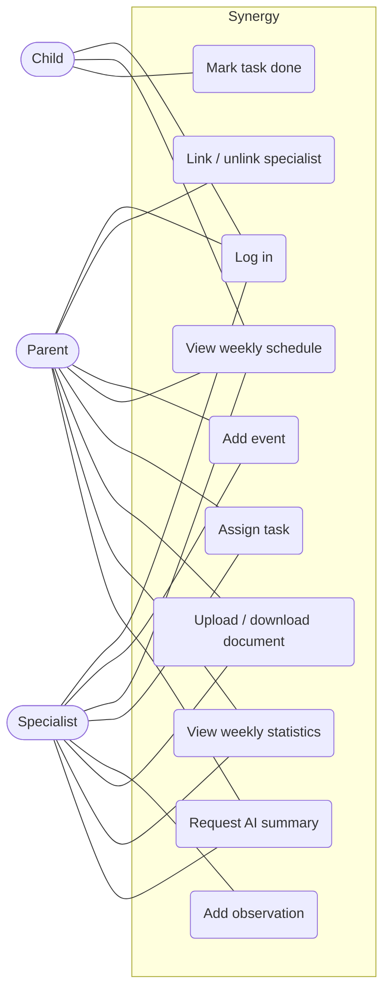

# Software Requirements Specification (SRS)

**Team name:** Synergy  
**Version:** ☑ First version (Week 6) ☐ Final (Week 10)  
**Last updated:** 2026-11-02

---

## 1. Introduction

**Purpose of the system:**  
A child's development is followed by many people at once (parents, teachers, psychologists, doctors, special education teachers, coaches), each keeping separate notes and schedules. Synergy is a web-based decision support platform that brings them together around one shared weekly schedule, task list and record of observations. An AI component summarizes the week's records for each reader according to their role; the AI supports decisions but never makes them.

**Users of the system:**

| User type | Description |
|---|---|
| Parent | Owns the child's data. Sees all of the child's records, links and unlinks specialists, adds events and tasks, uploads documents and reads the parent AI summary. |
| Specialist | A teacher, psychologist, doctor, special education teacher or coach. Works only with the children they are linked to: adds events, tasks and observations, uploads documents and reads the specialist AI summary. |
| Child | Sees only their own tasks and weekly schedule, and marks their tasks as done. Cannot see observations, documents or AI summaries. |

**Scope notes:** Only synthetic data created by a seed script is used. The application runs locally by following the README. Field-level permissions, email invitations, an admin panel, mobile apps and cloud deployment are out of scope.

---

## 2. Functional Requirements

> Priority: **Must** (required for v1.0) / **Should** (planned) / **Could** (if time allows).

### M1 – Login and roles

| ID | Requirement | Priority |
|---|---|---|
| FR-M1-01 | The system shall let a registered user log in with an email and a password. | Must |
| FR-M1-02 | The system shall reject a login with an unknown email or a wrong password and show an error message without saying which of the two was wrong. | Must |
| FR-M1-03 | The system shall take the user's role (parent, specialist or child) from the account; the user shall not choose a role at login. | Must |
| FR-M1-04 | The system shall issue a signed JWT after a successful login and require a valid token for every API request except login. | Must |
| FR-M1-05 | The system shall show each role only its own screens and redirect a user who opens another role's screen. | Must |
| FR-M1-06 | The system shall let the user log out, after which protected screens are no longer accessible. | Must |

### M2 – Linking specialists

| ID | Requirement | Priority |
|---|---|---|
| FR-M2-01 | The system shall let a parent link a registered specialist to their child by entering the specialist's email and specialist type. | Must |
| FR-M2-02 | The system shall show an error when the entered email does not belong to a registered specialist. | Must |
| FR-M2-03 | The system shall list the specialists linked to the child, with name, type and link date. | Must |
| FR-M2-04 | The system shall let a parent unlink a specialist after a confirmation step. | Must |
| FR-M2-05 | The system shall reject, in the API, every request by an unlinked specialist about the child, even if the specialist holds a valid token. | Must |
| FR-M2-06 | The system shall show a specialist the list of children they are linked to. | Must |
| FR-M2-07 | The system shall reject linking a specialist who is already linked to the child. | Must |
| FR-M2-08 | The system shall allow a parent to link, unlink and view data only for their own child. | Must |

### M3 – Weekly schedule

| ID | Requirement | Priority |
|---|---|---|
| FR-M3-01 | The system shall let a parent or a linked specialist add an event with a title, date, start time, end time and optional description. | Must |
| FR-M3-02 | The system shall list the child's events for a selected week in a weekly view, grouped by day. | Must |
| FR-M3-03 | The system shall let the user move to the previous and next week. | Must |
| FR-M3-04 | The system shall show the child their own events for the current week. | Must |
| FR-M3-05 | The system shall reject an event whose end time is before its start time. | Must |
| FR-M3-06 | The system shall let the creator of an event edit or delete it. | Should |

### M4 – Tasks

| ID | Requirement | Priority |
|---|---|---|
| FR-M4-01 | The system shall let a parent or a linked specialist assign a task to the child with a title, description, development area and due date. | Must |
| FR-M4-02 | The system shall show the child a list of their own tasks with title, area, due date and status. | Must |
| FR-M4-03 | The system shall let the child mark one of their own tasks as done. | Must |
| FR-M4-04 | The system shall show the assigner the status (pending / done) of the tasks they assigned. | Must |
| FR-M4-05 | The system shall reject a task that has no title, no development area or no due date. | Must |
| FR-M4-06 | The system shall prevent a child from changing tasks that belong to another child. | Must |

### M5 – Specialist entries

| ID | Requirement | Priority |
|---|---|---|
| FR-M5-01 | The system shall let a linked specialist add a dated observation about the child, with a development area and text. | Must |
| FR-M5-02 | The system shall let a specialist edit their own observation and mark an edited observation as "edited" with the edit date. | Must |
| FR-M5-03 | The system shall list the child's observations, newest first, to the parent and to linked specialists. | Must |
| FR-M5-04 | The system shall not show observations to the child, in the interface or through the API. | Must |
| FR-M5-05 | The system shall prevent a specialist from editing another specialist's observation. | Must |

### M6 – Documents

| ID | Requirement | Priority |
|---|---|---|
| FR-M6-01 | The system shall let a parent or a linked specialist upload a PDF or image file (JPEG, PNG) for the child. | Must |
| FR-M6-02 | The system shall reject files of other types and files larger than 5 MB. | Must |
| FR-M6-03 | The system shall list the child's documents with name, type, uploader and upload date. | Must |
| FR-M6-04 | The system shall let the parent and linked specialists view and download a document. | Must |
| FR-M6-05 | The system shall not show documents to the child, in the interface or through the API. | Must |

### M7 – Weekly statistics

| ID | Requirement | Priority |
|---|---|---|
| FR-M7-01 | The system shall calculate the task completion rate for a selected week as completed tasks divided by tasks due that week. | Must |
| FR-M7-02 | The system shall show the completion rate for the week in total and for each development area. | Must |
| FR-M7-03 | The system shall show "no tasks" instead of a rate for a week or area with no tasks. | Must |
| FR-M7-04 | The system shall show the statistics to the parent and to linked specialists. | Must |

### M8 – Role-based AI summary

| ID | Requirement | Priority |
|---|---|---|
| FR-M8-01 | The system shall generate a summary of a selected week's records (events, tasks and their status, observations) when a parent or linked specialist requests it. | Must |
| FR-M8-02 | The system shall use a separate prompt for the parent and for the specialist. | Must |
| FR-M8-03 | The system shall send the AI service only records the requesting user is allowed to see. | Must |
| FR-M8-04 | The system shall label every summary "AI-generated" and list links to the source records it is based on. | Must |
| FR-M8-05 | The system shall instruct the AI not to diagnose, suggest treatment or make decisions, and present the summary only as a suggestion. | Must |
| FR-M8-06 | The system shall provide a mock mode that returns a fixed summary without calling the AI service, used in tests and CI. | Must |
| FR-M8-07 | The system shall show a clear message when the AI service is unavailable, and the rest of the application shall keep working. | Must |

---

## 3. Non-Functional Requirements

| ID | Category | Requirement |
|---|---|---|
| NFR-01 | Security | Passwords are stored only as bcrypt hashes; the AI API key and JWT secret are kept in a backend `.env` file that is never committed. |
| NFR-02 | Security | Every API endpoint that returns child data checks the user's role and the current specialist–child link on the server side. |
| NFR-03 | Performance | With the seed data, every page except the AI summary loads in under 2 seconds on a local machine. |
| NFR-04 | Maintainability | Backend branch coverage is at least 40% at v0.2 and at least 60% at v1.0, measured in CI. |
| NFR-05 | Installability | A new developer can install and run the application by following the README in under 15 minutes. |

---

## 4. Critical Flows and Acceptance Criteria

| Flow | Related requirements | Acceptance criteria |
|---|---|---|
| Flow 1: Specialist assigns a task and the child completes it | FR-M1-01, FR-M2-05, FR-M4-01, FR-M4-03, FR-M4-04 | **Given** a specialist linked to a child **When** the specialist assigns the task "Read for 20 minutes" and the child logs in and marks it done **Then** the task appears in the child's list and the specialist sees its status as "done". |
| Flow 2: Parent unlinks a specialist and access is removed | FR-M2-01, FR-M2-04, FR-M2-05 | **Given** a specialist linked to a child **When** the parent unlinks the specialist and the specialist then requests the child's tasks **Then** the API returns an error (403) and the child no longer appears in the specialist's list. |
| Flow 3: Parent views the weekly AI summary | FR-M7-02, FR-M8-01, FR-M8-04, FR-M8-06 | **Given** a child with tasks and observations in the current week and the AI service in mock mode **When** the parent opens the weekly dashboard and requests the summary **Then** the summary is shown with the "AI-generated" label and links to its source records. |

---

## 5. Use Case Diagram

---

## 6. Change Log

| Date | Change | By |
|---|---|---|
| 2026-11-02 | First version: requirements for M1–M8, non-functional requirements and critical flows | Synergy team |
| 2026-11-03 | Reviewed M1, M2, M6 requirements; added FR-M2-07, FR-M2-08 | Aleyna Tanrıverdi |